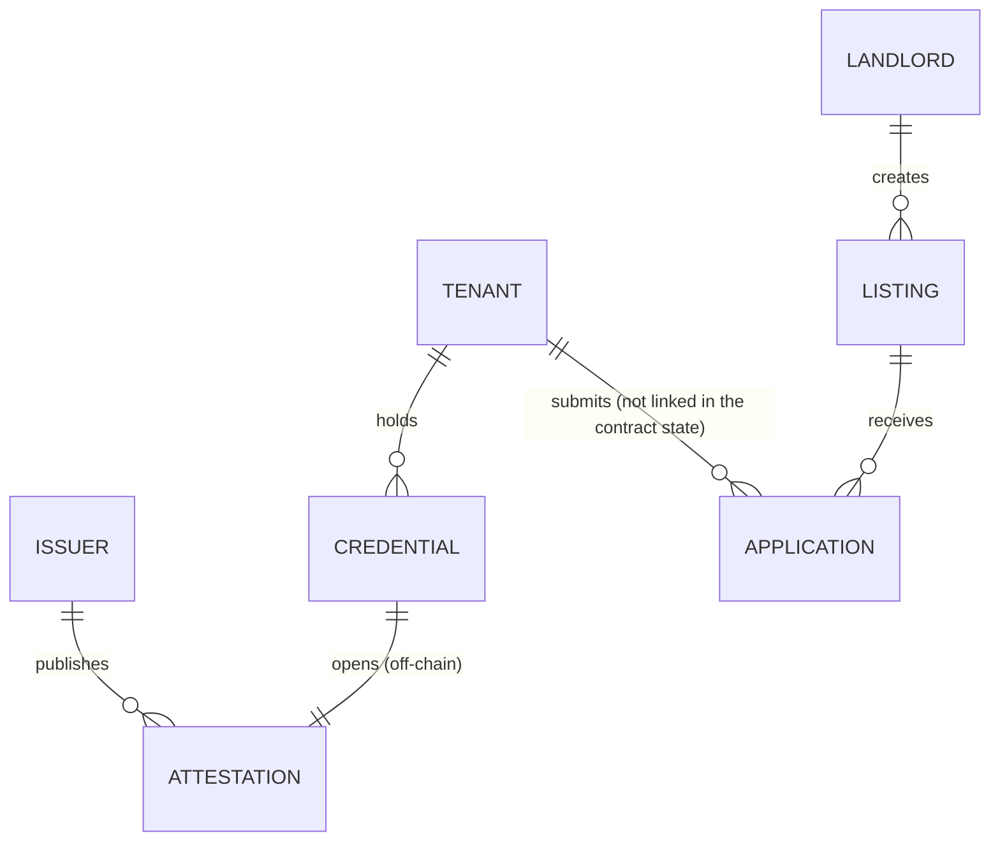

# Data model: TenantProof

There is no database. Data lives in two places:

- **Public ledger** of the contract: `contract/tenant-proof.compact`. Everyone can read it.
- **Private state** on each user's device: `TenantProofPrivateState` in `contract/witnesses.ts`. Read by the circuits as witness inputs; never written to the ledger.

These two files are the source of truth for fields. This document records entities, ownership and invariants.

## Entities
| Entity | What it is | Where | Owned by |
| --- | --- | --- | --- |
| Issuer key | `issuerPk = publicKey(issuer secret)`, set once by the constructor (`sealed`) | Ledger | Issuer (the deployer) |
| Attestation | Leaf `persistentCommit([income, tenantPk, expiresAt], salt)` in a `HistoricMerkleTree<10>`; plus `attestationCount`. Its index is its order of attestation (0 = first) | Ledger | Published by the issuer |
| Revocation | `revoked: Set<Uint<64>>` of attestation indices; the leaf at a revoked index is reset to the default value | Ledger | The issuer |
| Credential | `income` + `expiresAt` (seconds since the epoch) + `salt` the issuer hands the tenant off-chain for one attestation | Tenant device | Tenant |
| Listing | `listingId → { label, rent, multiplierTenths, open }` (`Map<Bytes<32>, Listing>`), where `listingId = hash("tenantproof:listing:", label, landlord secret)` | Ledger | The landlord whose secret key derives its id (the key itself is not stored) |
| Application | `applicationId → listingId`, where `applicationId = hash("tenantproof:app:", listingId, tenant secret)` | Ledger | Tenant (unlinked to them in the contract's public state; the transactions that carried it are separate public data, see docs/SECURITY.md "Wallet (Lace)") |
| Private state | `secretKey`, and for tenants `income?`, `incomeSalt?`, `expiresAt?` | User device | Each user |

## Relationships

## Invariants (enforced by the circuits)
- Only the holder of the issuer secret can call `attest` ("Only the issuer can attest").
- A listing id is derived in the circuit from the label and the caller's secret key, so only that key can create or close it. It is unique, its rent is greater than zero, and its multiplier is 10–100 tenths (1.0×–10.0×).
- Rent and multiplier never change after creation. `closeListing` only sets `open` to false; nothing sets it back, and a closed label cannot be listed again by the same key.
- Only the issuer can call `revoke` ("Only the issuer can revoke"), only for an index below `attestationCount` ("Unknown attestation"), and only once per index ("Already revoked"). It resets that leaf and the root history; nothing un-revokes.
- `apply(listingId, checkTime)` succeeds only if the listing is open, block time ≤ `checkTime` ("Check time is in the past"), the tenant's leaf, recomputed from their secret key, income, expiry and salt, is in the attestation tree under a valid historic root (none from before the last revocation), `expiresAt ≥ checkTime` ("Attestation has expired"), and `income * 10 >= multiplierTenths * rent`.
- At most one application per (tenant secret, listing). Applications are never removed: expiry or revocation of the attestation does not touch them.
- The tenant's secret key, public key, income, expiry and salt never appear on the ledger (checked by the "keeps secrets out of public state" test). `checkTime` is a public transaction input, not ledger state.

## Known limits (planned changes, see `docs/BRIEF.md` milestones)
- Expiry and revocation stop new applications only; applications already made stay.
- The last one to two hours of an attestation's validity cannot be used (`checkTimeFor` rounds the public check time up to the next hour plus one).
- A revocation resets the root history, so every proof built before it (any tenant's) must be built again. Revoked slots are not reused.
- One issuer, fixed at deploy.
- The tree holds 1024 leaves (depth 10).
- Labels are not unique (each key has its own id for a label); tenants must use the full listing id.
- Only the landlord's secret key can close a listing; if that key is lost, the listing stays open for good (no recovery).
- A contract deployed before S5 (no `revoked` set; before S4, listings as `id → rent`) cannot be read by the current code.

## Conventions
- [x] Ids are 32 bytes, shown as hex. A listing label is UTF-8, 1–32 bytes, zero-padded (`listingLabelBytes` in `src/attest.ts`); the listing id is `listingIdFor(label, landlordSecret)`.
- [x] Multipliers are whole tenths (`Uint<8>`, 30 = 3.0×), typed as `3` or `2.5` (`parseMultiplierTenths`: a dot and at most one decimal; a comma is refused, not guessed).
- [x] Amounts are `Uint<32>` (`bigint` in TypeScript), whole numbers, never float. Currency: TODO (rents in the demo have no currency).
- [x] Income is hashed as `income as Field as Bytes<32>` (little-endian 32 bytes); `expiresAt` the same way, as a `Uint<64>`.
- [x] Times are whole seconds since 1970-01-01 UTC (`Uint<64>`, `bigint`); a credential carries `expiresAt` as a decimal string, parsed digits-only (`parseExpiresAt`). Validity is typed as whole days (`parseValidDays`, 1–3650).
- [x] Domain-separated hashes: `"tenantproof:pk:"`, `"tenantproof:app:"`, `"tenantproof:listing:"`.
- [ ] On-chain references (contract address, tx hash) are always stored with the network they belong to.
- [ ] Changing a ledger field or circuit means recompiling and redeploying; there is no in-place migration. TODO: how deployed contracts are versioned and how the UI picks one.
