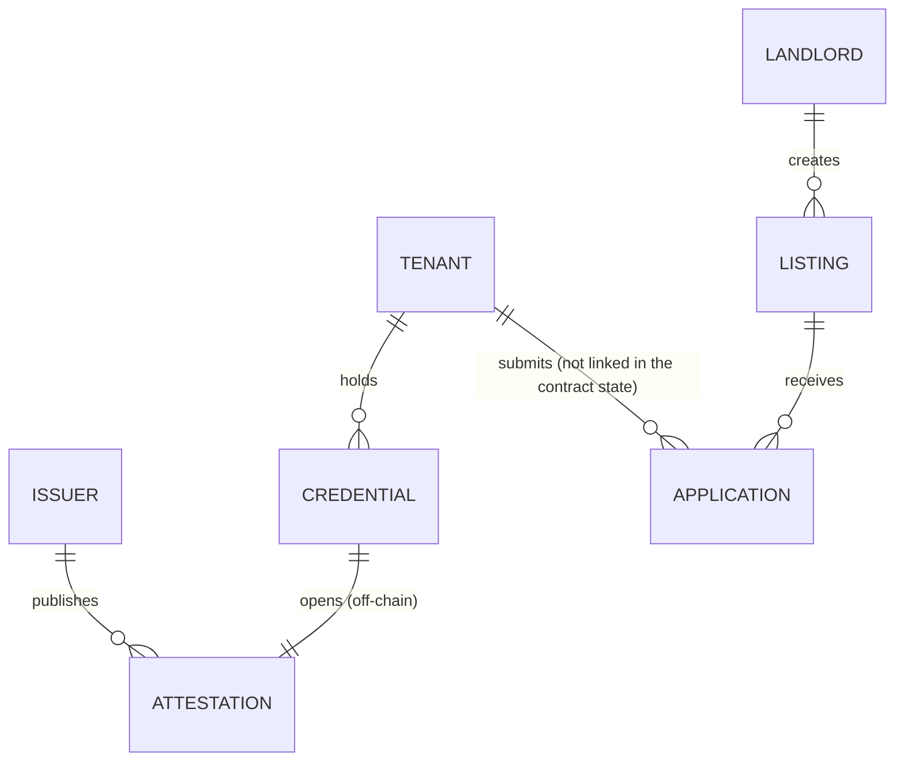

# Data model: TenantProof

There is no database. Data lives in two places:

- **Public ledger** of the contract: `contract/tenant-proof.compact`. Everyone can read it.
- **Private state** on each user's device: `TenantProofPrivateState` in `contract/witnesses.ts`. Read by the circuits as witness inputs; never written to the ledger.

These two files are the source of truth for fields. This document records entities, ownership and invariants.

## Entities
| Entity | What it is | Where | Owned by |
| --- | --- | --- | --- |
| Issuer key | `issuerPk = publicKey(issuer secret)`, set once by the constructor (`sealed`) | Ledger | Issuer (the deployer) |
| Attestation | Leaf `persistentCommit([income, tenantPk], salt)` in a `HistoricMerkleTree<10>`; plus `attestationCount` | Ledger | Published by the issuer |
| Credential | `income` + `salt` the issuer hands the tenant off-chain for one attestation | Tenant device | Tenant |
| Listing | `listingId → rent` (`Map<Bytes<32>, Uint<32>>`) | Ledger | Whoever created it (not bound to a key yet) |
| Application | `applicationId → listingId`, where `applicationId = hash("tenantproof:app:", listingId, tenant secret)` | Ledger | Tenant (unlinked to them in the contract's public state; the transactions that carried it are separate public data, see docs/SECURITY.md "Wallet (Lace)") |
| Private state | `secretKey`, and for tenants `income?`, `incomeSalt?` | User device | Each user |

## Relationships

## Invariants (enforced by the circuits)
- Only the holder of the issuer secret can call `attest` ("Only the issuer can attest").
- A listing id is unique and its rent is greater than zero.
- `apply` succeeds only if the tenant's leaf, recomputed from their secret key, income and salt, is in the attestation tree under a valid historic root, and `income >= 3 * rent`.
- At most one application per (tenant secret, listing).
- The tenant's secret key, public key, income and salt never appear on the ledger (checked by the "keeps secrets out of public state" test).

## Known limits (planned changes, see `docs/BRIEF.md` milestones)
- Attestations never expire and cannot be revoked.
- One issuer, fixed at deploy.
- The tree holds 1024 leaves (depth 10).
- Anyone can create a listing, including taking another landlord's listing id; the multiplier is fixed at 3.

## Conventions
- [x] Ids are 32 bytes, shown as hex. `listingId` is a UTF-8 label of 1–32 bytes, zero-padded (`listingIdFromLabel` in `src/attest.ts`).
- [x] Amounts are `Uint<32>` (`bigint` in TypeScript), whole numbers, never float. Currency: TODO (rents in the demo have no currency).
- [x] Income is hashed as `income as Field as Bytes<32>` (little-endian 32 bytes).
- [x] Domain-separated hashes: `"tenantproof:pk:"`, `"tenantproof:app:"`.
- [ ] On-chain references (contract address, tx hash) are always stored with the network they belong to.
- [ ] Changing a ledger field or circuit means recompiling and redeploying; there is no in-place migration. TODO: how deployed contracts are versioned and how the UI picks one.
